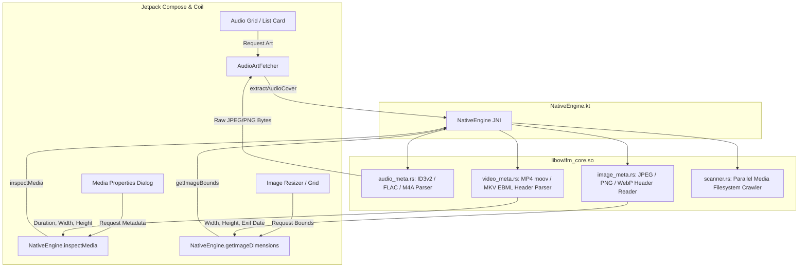

# Implementation Plan: Hybrid Rust Media Engine (Images, Videos & Music)

This plan details the design and implementation of the **Hybrid Rust Media Engine** for OwlFM+, bringing high-performance native parsing and indexing to Images, Videos, and Audio files while adhering to Android platform conventions and project rules.

---

## 1. Goal Description

On Android, inspecting media files (extracting Album Art from MP3/FLAC, reading image dimensions/EXIF, or fetching video duration/resolution) is traditionally handled via `MediaMetadataRetriever`, `BitmapFactory.Options(inJustDecodeBounds=true)`, or `ExifInterface`. These Android SDK classes suffer from:
1. **Severe Latency & IPC Overhead**: `MediaMetadataRetriever` creates an Android IPC Binder transaction to `libstagefright` per file, taking **40ms – 100ms** per file and easily freezing UI lists.
2. **JVM Heap Pressure & GC Pauses**: `BitmapFactory` allocates JVM heap structures and native bitmaps that cause stutter when scrolling through media folders.
3. **Flaky & Missing Metadata**: Files downloaded from browsers or messaging apps (Zalo, Telegram, WhatsApp) or lossless formats (FLAC, OPUS, OGG, M4A) frequently lack tags or album covers in `MediaStore`.

### Solution:
Build a lightweight, zero-heap **Rust Native Media Engine** that directly parses binary headers in micro-seconds (< 0.5ms per file), extracts embedded cover art and metadata, and provides Rayon-parallel filesystem scanning for missing media.



---

## 2. Architecture & Design Principles

> [!IMPORTANT]
> **Hardware vs Software Video Frame Decoding**:
> Video thumbnail frame extraction (rendering an actual frame at 1s timestamp) will **continue using Android Q+ hardware-accelerated `ThumbnailUtils`** (which leverages the device GPU/DSP hardware decoder). Rust will handle **video header parsing** (resolution, duration, timescale, codecs) and **parallel filesystem discovery** in micro-seconds. Software frame decoding on CPU in Rust is intentionally avoided to preserve battery life and prevent device overheating.

> [!NOTE]
> **Preservation of English UI**:
> All newly exposed properties, dialog labels, toasts, and metadata badges in Compose UI will be strictly in English (e.g. `Bitrate`, `Sample Rate`, `Duration`, `Dimensions`, `Artist`, `Album`).

---

## 3. Proposed Changes

### Component 1: Rust Audio Engine (`rust-core/src/audio_meta.rs`)
Directly parse audio container headers without `MediaMetadataRetriever`:
- **MP3 (ID3v2.3 / ID3v2.4)**:
  - Header: Reads 10-byte ID3 header + size.
  - Frame `APIC` (Attached Picture): Extract embedded album art bytes (JPEG/PNG) directly.
  - Frames `TIT2` (Title), `TPE1` (Artist), `TALB` (Album), `TYER`/`TDRC` (Year), `TLEN` (Duration).
- **FLAC**:
  - Magic `fLaC`.
  - Block header 4 (`VORBIS_COMMENT`): Title, Artist, Album.
  - Block header 6 (`METADATA_BLOCK_PICTURE`): Cover art MIME type & raw image bytes.
  - StreamInfo block: Sample rate, channels, total samples (duration).
- **M4A / AAC (MP4 ISO Base Media)**:
  - Atoms: `moov` -> `udta` -> `meta` -> `ilst` -> `covr` (raw picture bytes), `©nam` (title), `©ART` (artist), `©alb` (album).

#### [NEW] `rust-core/src/audio_meta.rs`
- `extract_audio_cover(path: &str) -> io::Result<Option<Vec<u8>>>`
- `parse_audio_tags(path: &str) -> io::Result<AudioMetadata>`

---

### Component 2: Rust Image Header & EXIF Engine (`rust-core/src/image_meta.rs`)
Zero-heap dimension and EXIF parser without starting `BitmapFactory`:
- **JPEG**: Scan markers until SOF0/SOF2 (`0xFF, 0xC0` / `0xC2`) for native WxH. Parse APP1 marker (`0xFF, 0xE1`) for EXIF orientation and `DateTimeOriginal`.
- **PNG**: Read first 24 bytes (8-byte signature + 16-byte `IHDR` chunk: width 4B BE, height 4B BE).
- **WebP**: Read first 30 bytes (`RIFF` ... `WEBP` ... `VP8 ` / `VP8L` / `VP8X` canvas width and height).
- **GIF**: Read first 10 bytes (`GIF87a`/`GIF89a` logical screen width & height).

#### [NEW] `rust-core/src/image_meta.rs`
- `get_image_metadata(path: &str) -> io::Result<ImageMetadata>` (width, height, orientation, date_time)

---

### Component 3: Rust Video Header Engine (`rust-core/src/video_meta.rs`)
Fast user-space MP4 / MKV header parser:
- **MP4 / MOV**: Parse `moov` atom:
  - `mvhd` atom: extracts timescale and duration.
  - `trak` -> `mdia` -> `minf` -> `stbl` / `tkhd`: extracts video track width & height.
- **MKV / WebM**: Parse EBML Header:
  - Element `0x1549A966` (Info): `Duration`.
  - Element `0x1654AE6B` (Tracks) -> Video: `PixelWidth`, `PixelHeight`.

#### [NEW] `rust-core/src/video_meta.rs`
- `parse_video_metadata(path: &str) -> io::Result<VideoMetadata>` (duration_ms, width, height, format)

---

### Component 4: JNI Bridge & Rust Library Updates
#### [MODIFY] `rust-core/src/lib.rs`
- Expose JNI methods:
  - `Java_com_antigravity_filemanager_core_NativeEngine_extractAudioCover` -> `jbyteArray`
  - `Java_com_antigravity_filemanager_core_NativeEngine_getAudioMetadata` -> `jstring`
  - `Java_com_antigravity_filemanager_core_NativeEngine_getImageMetadata` -> `jstring`
  - `Java_com_antigravity_filemanager_core_NativeEngine_getVideoMetadata` -> `jstring`

#### [MODIFY] `app/src/main/java/com/antigravity/filemanager/core/NativeEngine.kt`
- Add data classes: `AudioMetadata`, `ImageMetadata`, `VideoMetadata`.
- Add external JNI declarations and Kotlin convenience wrapper functions.

---

### Component 5: Kotlin App Integration
#### [MODIFY] `app/src/main/java/com/antigravity/filemanager/utils/AudioArtFetcher.kt`
- Use `NativeEngine.extractAudioCover(file.absolutePath)` as the primary fast-path before falling back to `MediaMetadataRetriever`.
- Returns `DrawableResult` directly from byte array in < 1ms, eliminating UI stutter on music grids.

#### [MODIFY] `app/src/main/java/com/antigravity/filemanager/utils/ImageResizerEngine.kt`
- In `getImageDimensions(file)`: Call `NativeEngine.getImageMetadata(file.absolutePath)` to retrieve width, height, and orientation without calling `BitmapFactory.Options` or `ExifInterface`.

#### [MODIFY] `app/src/main/java/com/antigravity/filemanager/presentation/components/Dialogs.kt`
- Enhance `PropertiesDialog`:
  - When inspecting an **Audio file**: Display `Artist`, `Album`, `Duration`, `Bitrate`.
  - When inspecting a **Video file**: Display `Resolution` (e.g. 1920x1080), `Duration`.
  - When inspecting an **Image file**: Display `Dimensions` (e.g. 4032x3024) and EXIF Date.

#### [MODIFY] `app/src/main/java/com/antigravity/filemanager/data/local/storage/LocalFileScanner.kt`
- In `queryAudioFolders` and `queryVideoFolders`: Use `NativeEngine.scanDocumentsFast` (or generalized `NativeEngine.scanMediaFast`) to scan standard media directories (`Music`, `Podcasts`, `Movies`, `DCIM`, `Download`) concurrently via Rayon, replacing sequential Java `listFiles()` loops.

---

## 4. Verification Plan

### Automated Tests
1. **Host Unit Tests**:
   ```powershell
   ./gradlew testDebugUnitTest
   ```
   Add assertions in `NativeEngineTest.kt` verifying that `extractAudioCover`, `getAudioMetadata`, `getImageMetadata`, and `getVideoMetadata` handle missing native library safely on host JVM.
2. **Rust Cargo Check**:
   ```powershell
   cargo check --manifest-path rust-core/Cargo.toml
   ```

### Cross-Compilation & Packaging
1. Compile native release libraries for all 3 targets:
   ```powershell
   cargo build --release --target aarch64-linux-android --manifest-path rust-core/Cargo.toml
   cargo build --release --target armv7-linux-androideabi --manifest-path rust-core/Cargo.toml
   cargo build --release --target x86_64-linux-android --manifest-path rust-core/Cargo.toml
   ```
2. Copy `.so` binaries to `app/src/main/jniLibs/`.
3. Verify release minification with R8:
   ```powershell
   ./gradlew assembleRelease
   ```
   Ensure `app/build/outputs/apk/release/app-release.apk` builds successfully with zero R8 warnings/errors.
